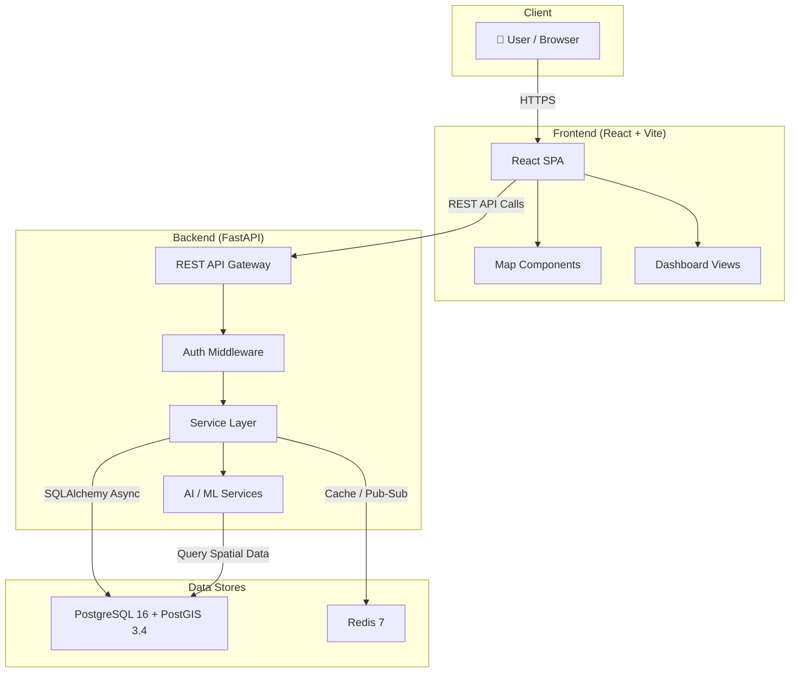
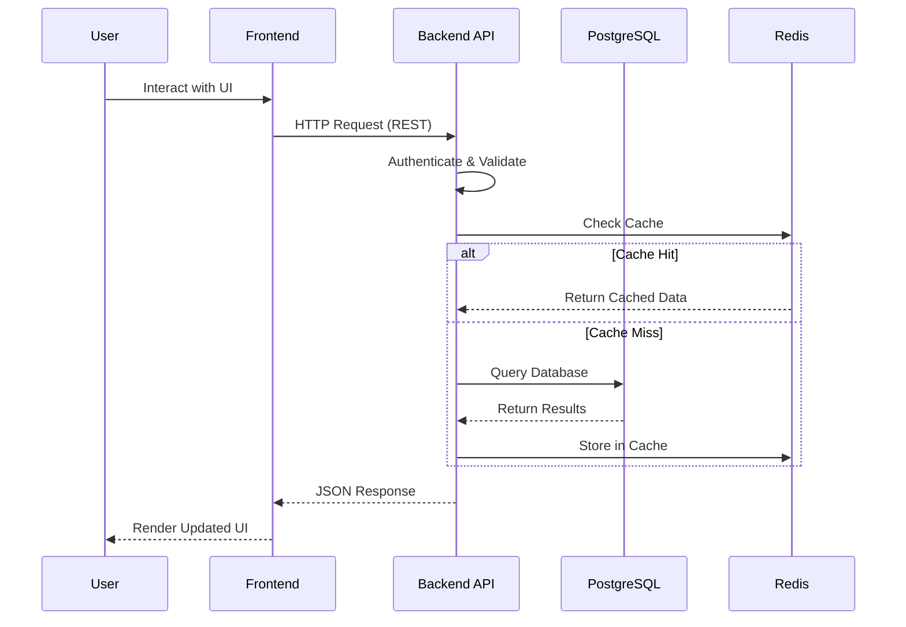

# Architecture — NAGARPAALAN AI

> Modular Civic Infrastructure Intelligence Platform

---

## System Overview

NAGARPAALAN AI follows a **layered, modular architecture** designed for clarity, scalability, and developer ergonomics. The system separates concerns across four tiers:

1. **Presentation Layer** — React-based SPA for interactive dashboards, maps, and data visualization.
2. **Application Layer** — FastAPI backend exposing a RESTful API with business logic, authentication, and AI service orchestration.
3. **Data Layer** — PostgreSQL with PostGIS for persistent relational and geospatial storage; Redis for caching, rate-limiting, and pub/sub messaging.
4. **Infrastructure Layer** — Docker Compose for local development orchestration; designed for future Kubernetes deployment.

---

## Architecture Diagram

---

## Component Descriptions

### Frontend

| Component          | Responsibility                                                                 |
|--------------------|--------------------------------------------------------------------------------|
| **React SPA**      | Single-page application shell; handles routing, layout, and global state.      |
| **Map Components** | Leaflet/Mapbox-based interactive maps for geospatial visualization.            |
| **Dashboard Views**| Data tables, charts, and KPI cards for civic infrastructure monitoring.         |
| **API Client**     | Axios/fetch-based service layer for communicating with the backend REST API.    |

### Backend

| Component              | Responsibility                                                              |
|------------------------|-----------------------------------------------------------------------------|
| **REST API Gateway**   | FastAPI router dispatching requests to appropriate service handlers.         |
| **Auth Middleware**     | JWT-based authentication and role-based access control (RBAC).              |
| **Service Layer**      | Core business logic — validation, orchestration, domain rules.              |
| **AI / ML Services**   | Integration layer for AI models — anomaly detection, predictive analytics.  |
| **ORM (SQLAlchemy 2)** | Async database access using the repository pattern.                         |
| **Alembic Migrations** | Schema versioning and migration management.                                 |

### Data Stores

| Component                     | Responsibility                                                        |
|-------------------------------|-----------------------------------------------------------------------|
| **PostgreSQL 16 + PostGIS**   | Primary relational store with spatial indexing and geospatial queries. |
| **Redis 7**                   | Fast key-value cache, session store, task queue broker, pub/sub.       |

---

## Data Flow

### Typical Request Lifecycle

### Geospatial Query Flow

1. User draws a region on the map (polygon selection).
2. Frontend sends the GeoJSON geometry to the API.
3. Backend constructs a PostGIS spatial query (`ST_Contains`, `ST_Intersects`, etc.).
4. PostgreSQL returns matching infrastructure records with geometry.
5. Backend serializes results as GeoJSON FeatureCollection.
6. Frontend renders features on the map layer.

---

## Phase 0 Scope

Phase 0 establishes the project foundation with these deliverables:

| Deliverable                  | Status   | Description                                           |
|------------------------------|----------|-------------------------------------------------------|
| Project scaffolding          | ✅ Done  | Mono-repo structure, tooling, and configuration.      |
| Infrastructure (Docker)      | ✅ Done  | PostgreSQL + PostGIS and Redis via Docker Compose.     |
| Backend skeleton             | 🔧 Next  | FastAPI app with health endpoints and config loading.  |
| Frontend skeleton            | 🔧 Next  | React + Vite app with routing and basic layout.        |
| Database schema (v1)         | 🔧 Next  | Core tables — users, wards, grievances, assets.        |
| CI/CD pipeline               | 📋 Later | GitHub Actions for lint, test, build.                  |

---

## Future Phases

### Phase 1 — Core Platform

- User authentication (JWT + RBAC)
- Ward and asset management CRUD
- Citizen grievance submission and tracking
- Basic map visualization with PostGIS data

### Phase 2 — Intelligence Layer

- AI-driven anomaly detection on infrastructure sensors
- Predictive maintenance scheduling
- Natural language grievance categorization
- Dashboard analytics and KPI tracking

### Phase 3 — Scale & Integrate

- Multi-tenancy (multiple municipal bodies)
- External data source integrations (weather, traffic, IoT)
- Mobile-responsive PWA
- Kubernetes deployment with Helm charts
- Observability stack (OpenTelemetry, Grafana, Loki)

### Phase 4 — Advanced AI

- Computer vision for infrastructure damage assessment (satellite/drone imagery)
- Conversational AI assistant for citizens
- Budget optimization and resource allocation models
- Digital twin simulation for urban planning

---

<em>Architecture evolves — this document is a living reference updated with each phase.</em>

